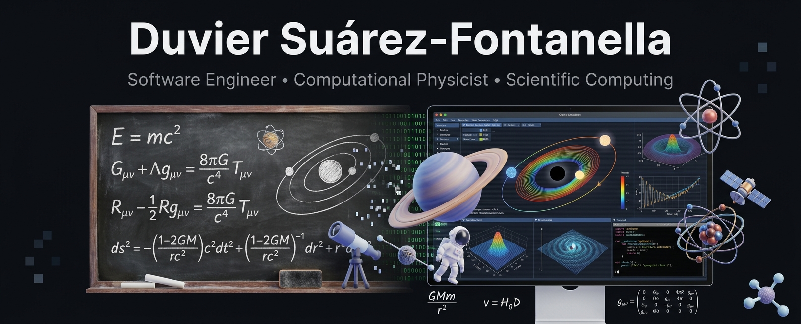

  

  
<strong>Software Engineering · Scientific Computing · Applied AI</strong>

  <a href="https://duviersuarezfontanella.es/">Personal website</a> ·
  <a href="https://github.com/Du92/aXemg">Featured code</a> ·
  <a href="https://orcid.org/0000-0002-3891-0187">Research profile</a>

---

### About

I am a software developer and computational physicist with a PhD in **Fundamental Physics and Mathematics**. My work combines **Python/C++ development**, numerical methods, data analysis, computer vision, and practical problem-solving.

I have experience developing software in research and industry, including work on **cybersecurity-related applications**. I enjoy turning complex problems into clear, testable, and reusable software.

### Languages & tools

  
  
  
  
  
  
  
  

### Selected work

**[aXemg — Axion Electrodynamics in Curved Spacetime](https://github.com/Du92/aXemg)**  
Modular Python framework for numerical modelling on fixed 3+1 spacetime backgrounds.

- 1D/2D finite-difference operators and RK4 integration
- YAML configuration and reproducible parameter studies
- Constraint diagnostics, tests, examples, and scientific visualization

**Stack:** Python · Numerical Methods · YAML · pytest

**[Personal Website](https://github.com/Du92/personal-website)**  
Personal academic website developed and published using Jekyll and GitHub Pages.

**Stack:** Jekyll · Markdown · CSS · GitHub Pages

**[Napkin Notes](https://napkinnotes.es/)**  
Independent science publication and digital product with web and Android distribution.

### Areas of interest

`Software engineering` · `Scientific software` · `Backend systems` · `Computer vision` · `High-performance computing` · `Data-intensive applications`

---

  <small>Explore my code and projects here on GitHub, or visit my <a href="https://duviersuarezfontanella.es/">personal website</a> for research and professional background.</small>

